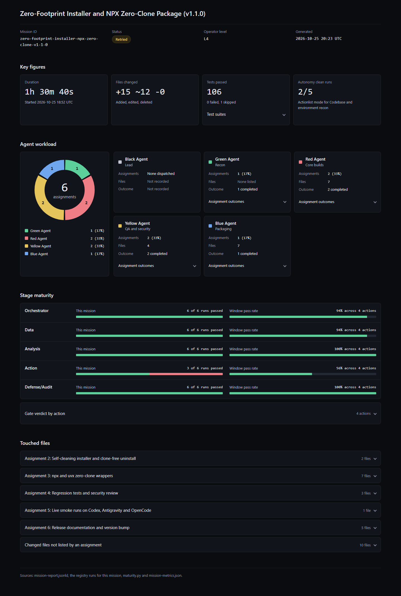
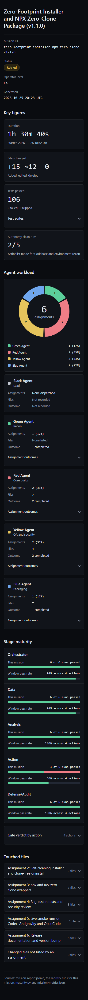

# ActionBoard V5 Agent Formation (multi-CLI)

Turn one objective into a reviewed plan, then execute it with specialist agents that never
touch the same file. **Nothing runs until you approve.**

Same mission flow on every supported CLI:

1. Black Agent drafts the **Mission Brief**
2. Green Agent runs read-only **recon**
3. Black Agent drafts **Agent Assignments** with file ownership
4. **Skills Gap** analysis
5. **Risk Register**
6. **Go/no-go gate** → you reply `go` → Red/Blue/Yellow execute
7. **Mission Report** (Markdown + schema.org JSON-LD)

| CLI | Tested version | Start a mission | Status |
|---|---|---|---|
| Claude Code | 2.1.310 | `/start-mission <objective>` | Supported; full mission passes live |
| OpenCode | 2.1.4 (1.x via a legacy guard plugin) | `/start-mission <objective>` in the TUI | Supported; full mission passes live |
| Codex CLI | 0.164.0 | `$start-mission <objective>` | Supported; full mission passes live (guard hook needs one-time `/hooks` trust) |
| Antigravity CLI (`agy`) | 1.4.7 | `/start-mission <objective>` | Supported; full mission passes live, `agy plugin validate --strict` passes |

Every CLI ran two full missions live (October 2026): preflight, Green recon, four-part plan, stop at
the go/no-go gate, build, tests re-run independently, maturity scoring. Results:
[`tests/smoke/results-2026-10.md`](tests/smoke/results-2026-10.md).

## Installation & Usage Guide

Pick your CLI and follow only that guide; each one is complete on its own. Every mission works
the same way everywhere: Black Agent plans, stops at the go/no-go gate, and nothing changes in
your project until you reply `go`.

> [!TIP]
> **🚀 Quick Start (Easiest way to get started)**
>
> **1. Claude Code (In-Chat / Zero Cloning):**
> Paste into Claude Code chat:
> ```sh
>  /plugin marketplace add Cloudscockpit/actionboard-build-mission-pipeline
>  /plugin install actionboard-v5-agentformation@actionboard-v5-agentformation
> ```
>
> **2. OpenCode CLI (npx, nothing left behind):**
> Run in your project folder (needs Node 18+ and Python 3.9+):
> ```sh
> npx @actionboard-ai/install --target opencode
> ```
>
> **3. Antigravity CLI (npx, nothing left behind):**
> Run in your project folder (needs Node 18+ and Python 3.9+):
> ```sh
> npx @actionboard-ai/install --target antigravity
> ```
>
> **4. Codex CLI (npx, nothing left behind):**
> Run in your project folder (needs Node 18+ and Python 3.9+):
> ```sh
> npx @actionboard-ai/install --target codex
> ```
>
> **No Node?** Use uv: `uvx --from "git+https://github.com/Cloudscockpit/ab-mission-command-center#subdirectory=packages/installer-py" actionboard-install --target <cli>`, or the git one-liner, which deletes its own clone:
> ```sh
> git clone --depth 1 https://github.com/Cloudscockpit/ab-mission-command-center.git && python ab-mission-command-center/scripts/install.py --target <opencode|antigravity|codex> --project . --cleanup
> ```
>
> Until v1.2.0 is tagged and published, `npx` and `uvx` answer "tag not published yet"; use the git one-liner until then.
>
> *(After installing, start a mission with `/start-mission <objective>`, or `$start-mission` on Codex)*

> [!NOTE]
> **💡 Pro-Tips for Terminal & One-Liner Users:**
>
> 1. **Zero footprint:** the `npx`, `uvx` and `--cleanup` paths leave no `ab-mission-command-center/` folder behind, so there is nothing to add to `.gitignore` or `.graphifyignore`. The installed files do not depend on the installer; they only reference your Python interpreter.
> 2. **Update & Removal:** re-run the install command to update. To remove, run the standalone uninstaller the installer left in your project; it needs no clone and deletes only unchanged files it created:
>    ```sh
>    python .codex/actionboard/actionboard_uninstall.py                                         # Codex
>    python .opencode/actionboard/actionboard_uninstall.py                                      # OpenCode
>    python .agents/plugins/actionboard-v5-agentformation/actionboard_uninstall.py              # Antigravity
>    ```
> 3. **Windows Users (`python` vs `py`):** If running `python` launches the Microsoft Store on Windows, simply use `py` instead.

### 1. Claude Code

**Requirements:** Claude Code (tested with 2.1.310). Python 3.9+ on PATH for the OpenShell guard
hook.

**Installation** — inside Claude Code:

```sh
/plugin marketplace add Cloudscockpit/ab-mission-command-center
/plugin install actionboard-v5-agentformation@actionboard-v5-agentformation
```

If the install summary says `Run /reload-plugins to activate.`, run `/reload-plugins`.

**Check it loaded** — in a terminal:

```sh
claude plugin details actionboard-v5-agentformation@actionboard-v5-agentformation
```

The plugin brings its own Context7 MCP server; `/mcp` inside Claude Code lists it.

**Start a mission:**

```
/start-mission add a /health endpoint that returns the service version
```

Your session plays Black Agent. It runs preflight, sends Green Agent on recon, shows the Mission
Brief, Agent Assignments, Skills Gap and Risk Register, then stops. Reply `go`, `no-go`, or
`edit <section>`.

**Slash commands:** every skill is in the `/` menu: `/mission-brief`, `/mission-plan`,
`/mission-report`, `/mission-preflight`, `/skills-registry`, `/actionboard-devops-mission`,
`/mission-harness`, `/sandbox-up`, `/sandbox-status`, `/sandbox-down`, `/policy-widen`,
`/terse-output`, `/browser-actions` (Claude in Chrome; Claude Code only).

**Cost options:** the first mission's preflight asks whether to install Graphify and whether to
turn on terse output, and saves your answers in `.actionboard/preferences.json`.

**Models:** Black Agent uses `opus`, the specialists use `sonnet`.

**Update / remove:**

```sh
claude plugin marketplace update
claude plugin update actionboard-v5-agentformation@actionboard-v5-agentformation
claude plugin uninstall actionboard-v5-agentformation@actionboard-v5-agentformation
```

**Notes for Claude Code:** on Windows the shell tool may be `PowerShell`; the guard covers both
`Bash` and `PowerShell`.

### 2. OpenCode

**Requirements:** OpenCode 2.x (tested with 2.1.4; 1.x gets a legacy guard plugin), Python 3.9+
(the install wrappers delegate to `scripts/install.py`), Node 18+ for `npx`, Git only for the
clone paths.

**Installation (npx, recommended)** — open a terminal in your project folder and run:

```sh
npx @actionboard-ai/install --target opencode
```

This downloads the installer into a temporary folder, installs into your project, and deletes the
temporary folder again, so nothing but OpenCode's own files lands in your project: there is no
clone to ignore, commit or index. Add `--global` to install for your user instead of the current
project. It needs Node 18+ for `npx` and Python 3.9+ on PATH, because the wrapper hands the work to
`scripts/install.py`. Until v1.2.0 is tagged and published, `npx` and `uvx` answer "tag not
published yet"; use the git one-liner below in the meantime.

**Installation (uvx, if you have uv but not Node):**

```sh
uvx --from "git+https://github.com/Cloudscockpit/ab-mission-command-center#subdirectory=packages/installer-py" actionboard-install --target opencode
```

**Installation (git one-liner, no Node or uv):**

```sh
git clone --depth 1 https://github.com/Cloudscockpit/ab-mission-command-center.git && python ab-mission-command-center/scripts/install.py --target opencode --project . --cleanup
```

`--cleanup` deletes the clone again once the install succeeded. It refuses, and leaves the clone
and the install untouched, unless the clone is a subfolder of your project, is a clean checkout of
`Cloudscockpit/ab-mission-command-center` (no edits, no untracked or ignored files, nothing
unpushed), and no `--config` file lives inside it. On Windows, if `python` opens the Microsoft
Store, use `py` instead. If you would rather keep a checkout for updates, leave `--cleanup` off
and see the step-by-step install below.

**Installation (step by step)** — if you prefer to keep a checkout, outside or inside your project, for updates:

```sh
git clone https://github.com/Cloudscockpit/ab-mission-command-center
cd ab-mission-command-center
python scripts/install.py --target opencode --project /path/to/your-project
```

Use `--global` instead of `--project …` to install for every project
(`~/.config/opencode/`). A project install writes to `<project>/.opencode/` and adds Context7 to
`<project>/opencode.json` (a `context7` server you already have is left alone). The installer
asks whether to install Graphify and whether to turn on terse output; skip the questions with
`--with graphify,terse` or `--without graphify,terse`.

**Check it loaded** — from the project directory:

```sh
opencode mcp list        # context7 should show as connected
```

Then start `opencode` and type `/`: `start-mission` and the other commands are listed.

**Start a mission** — in the interactive TUI:

```
/start-mission add a /health endpoint that returns the service version
```

It runs as the `black-agent` primary agent, stops at the gate, and waits for `go`.

> `opencode run "/start-mission …"` does **not** expand commands on OpenCode 2.x; the text goes to
> the default `build` agent, which skips the gate. For scripts, use
> `opencode run --agent black-agent "<objective>"`.

**Slash commands:** OpenCode does not show skills in `/`, so the package adds one command per
skill: `/mission-brief`, `/mission-plan`, `/mission-report`, `/mission-preflight`,
`/skills-registry`, `/actionboard-devops-mission`, `/mission-harness`, `/sandbox-up`,
`/sandbox-status`, `/sandbox-down`, `/policy-widen`, `/terse-output`.

**Models:** agents inherit the session model. To pin them, copy
`agentformation.config.example.json` to `agentformation.config.json`, edit the `opencode`
entry, and install with `--config agentformation.config.json`.

**Update / remove** — re-run the install command to update. To remove, no clone is needed:

```sh
npx @actionboard-ai/install --target opencode --uninstall
python .opencode/actionboard/actionboard_uninstall.py
```

The installer leaves `actionboard_uninstall.py` next to its manifest, so the second command works
with nothing but Python (add `--global` to the npx form for a user-level install). If you keep a
checkout instead, from your project folder:

```sh
git -C ab-mission-command-center pull
python ab-mission-command-center/scripts/install.py --target opencode --project .              # update
python ab-mission-command-center/scripts/install.py --target opencode --project . --uninstall  # remove
```

If you installed step by step, run the same commands from the clone with `git pull` and
`--project /path/to/your-project`.

Uninstall removes only the files the installer created, and only if you did not change them.

**Notes for OpenCode:** on 2.x the guard asks natively. On 1.x the legacy plugin cannot ask:
it lets a plain `openshell …` command reach the agents' ask rules and denies anything else.

### 3. Codex CLI

**Requirements:** Codex CLI (tested with 0.164.0), signed in with `codex login`. Python 3.9+
(the install wrappers delegate to `scripts/install.py`), Node 18+ for `npx`, Git only for the
clone paths.

**Installation (npx, recommended)** — open a terminal in your project folder and run:

```sh
npx @actionboard-ai/install --target codex
```

This downloads the installer into a temporary folder, installs into your project, and deletes the
temporary folder again, so nothing but Codex's own files lands in your project: there is no
clone to ignore, commit or index. Add `--global` to install for your user instead of the current
project. It needs Node 18+ for `npx` and Python 3.9+ on PATH, because the wrapper hands the work to
`scripts/install.py`. Until v1.2.0 is tagged and published, `npx` and `uvx` answer "tag not
published yet"; use the git one-liner below in the meantime.

**Installation (uvx, if you have uv but not Node):**

```sh
uvx --from "git+https://github.com/Cloudscockpit/ab-mission-command-center#subdirectory=packages/installer-py" actionboard-install --target codex
```

**Installation (git one-liner, no Node or uv):**

```sh
git clone --depth 1 https://github.com/Cloudscockpit/ab-mission-command-center.git && python ab-mission-command-center/scripts/install.py --target codex --project . --cleanup
```

`--cleanup` deletes the clone again once the install succeeded. It refuses, and leaves the clone
and the install untouched, unless the clone is a subfolder of your project, is a clean checkout of
`Cloudscockpit/ab-mission-command-center` (no edits, no untracked or ignored files, nothing
unpushed), and no `--config` file lives inside it. On Windows, if `python` opens the Microsoft
Store, use `py` instead. If you would rather keep a checkout for updates, leave `--cleanup` off
and see the step-by-step install below.

**Installation (step by step)** — if you prefer to keep a checkout, outside or inside your project, for updates:

```sh
git clone https://github.com/Cloudscockpit/ab-mission-command-center
cd ab-mission-command-center
python scripts/install.py --target codex --project /path/to/your-project
```

A project install writes skills to `<project>/.agents/skills/`, agents, rules and hooks to
`<project>/.codex/`, a block in `<project>/AGENTS.md`, and Context7 to
`<project>/.codex/config.toml`. Use `--global` for `~/.agents/skills/` and `~/.codex/`. The
installer asks about Graphify and terse output (or pass `--with` / `--without graphify,terse`).

**Trust the hooks (required once):** start `codex` in the project, run `/hooks`, and trust the
ActionBoard hooks. Until you do, the OpenShell guard does not run; Codex asks again whenever
the hooks change.

**Check it loaded:**

```sh
codex mcp list           # context7 should be listed
```

In Codex, `/skills` lists `start-mission` and the other skills.

**Start a mission** — Codex has no custom commands, so the mission is a skill:

```
$start-mission add a /health endpoint that returns the service version
```

Your session plays Black Agent and dispatches the specialists with `spawn_agent`. It stops at
the gate and waits for `go`.

**Skills:** invoke as `$mission-brief`, `$mission-plan`, `$mission-report`,
`$mission-preflight`, `$skills-registry`, `$actionboard-devops-mission`, `$mission-harness`,
`$sandbox-up`, `$sandbox-status`, `$sandbox-down`, `$policy-widen`, `$terse-output`, or pick
them from `/skills`.

**Models:** agents inherit the session model. To pin them, copy
`agentformation.config.example.json` to `agentformation.config.json`, edit the `codex` entry,
and install with `--config agentformation.config.json`.

**Update / remove** — re-run the install command to update. To remove, no clone is needed:

```sh
npx @actionboard-ai/install --target codex --uninstall
python .codex/actionboard/actionboard_uninstall.py
```

The installer leaves `actionboard_uninstall.py` next to its manifest, so the second command works
with nothing but Python (add `--global` to the npx form for a user-level install). If you keep a
checkout instead, from your project folder:

```sh
git -C ab-mission-command-center pull
python ab-mission-command-center/scripts/install.py --target codex --project .              # update
python ab-mission-command-center/scripts/install.py --target codex --project . --uninstall  # remove
```

If you installed step by step, run the same commands from the clone with `git pull` and
`--project /path/to/your-project`.

After an update, trust the changed hooks again with `/hooks`.

**Notes for Codex:** hooks cannot ask, so the guard denies risky commands unless a plain
`openshell …` command matches a `prompt` rule in `.codex/rules/actionboard.rules`, which then
asks. Codex has no per-agent tool limits, so read-only roles rely on their instructions.

### 4. Antigravity CLI (`agy`)

**Requirements:** Antigravity CLI (tested with 1.4.7). Python 3.9+ (the install wrappers
delegate to `scripts/install.py`), Node 18+ for `npx`, Git only for the clone paths.

**Installation (npx, recommended)** — open a terminal in your project folder and run:

```sh
npx @actionboard-ai/install --target antigravity
```

This downloads the installer into a temporary folder, installs into your project, and deletes the
temporary folder again, so nothing but Antigravity's own files lands in your project: there is no
clone to ignore, commit or index. Add `--global` to install for your user instead of the current
project. It needs Node 18+ for `npx` and Python 3.9+ on PATH, because the wrapper hands the work to
`scripts/install.py`. Until v1.2.0 is tagged and published, `npx` and `uvx` answer "tag not
published yet"; use the git one-liner below in the meantime.

**Installation (uvx, if you have uv but not Node):**

```sh
uvx --from "git+https://github.com/Cloudscockpit/ab-mission-command-center#subdirectory=packages/installer-py" actionboard-install --target antigravity
```

**Installation (git one-liner, no Node or uv):**

```sh
git clone --depth 1 https://github.com/Cloudscockpit/ab-mission-command-center.git && python ab-mission-command-center/scripts/install.py --target antigravity --project . --cleanup
```

`--cleanup` deletes the clone again once the install succeeded. It refuses, and leaves the clone
and the install untouched, unless the clone is a subfolder of your project, is a clean checkout of
`Cloudscockpit/ab-mission-command-center` (no edits, no untracked or ignored files, nothing
unpushed), and no `--config` file lives inside it. On Windows, if `python` opens the Microsoft
Store, use `py` instead. If you would rather keep a checkout for updates, leave `--cleanup` off
and see the step-by-step install below.

**Installation (step by step)** — if you prefer to keep a checkout, outside or inside your project, for updates:

```sh
git clone https://github.com/Cloudscockpit/ab-mission-command-center
cd ab-mission-command-center
python scripts/install.py --target antigravity --project /path/to/your-project
```

A project install writes the plugin to
`<project>/.agents/plugins/actionboard-v5-agentformation/`, with its own Context7 MCP config. Use
`--global` for `~/.gemini/config/plugins/actionboard-v5-agentformation/`. The installer asks
about Graphify and terse output (or pass `--with` / `--without graphify,terse`).

**Check it loaded** — from the project directory:

```sh
agy plugin list
```

In `agy`, type `/`: `start-mission` and the other skills are listed.

**Start a mission:**

```
/start-mission add a /health endpoint that returns the service version
```

Your session plays Black Agent (you can also run `agy --agent black-agent`). It stops at the
gate and waits for `go`.

**Slash commands:** every skill is a `/command`: `/mission-brief`, `/mission-plan`,
`/mission-report`, `/mission-preflight`, `/skills-registry`, `/actionboard-devops-mission`,
`/mission-harness`, `/sandbox-up`, `/sandbox-status`, `/sandbox-down`, `/policy-widen`,
`/terse-output` (internal skills such as `/openshell-admin` show too).

**Models:** Black Agent uses `pro`, the specialists use `flash`. To change them, copy
`agentformation.config.example.json` to `agentformation.config.json`, edit the `antigravity`
entry, and install with `--config agentformation.config.json`.

**Update / remove** — re-run the install command to update. To remove, no clone is needed:

```sh
npx @actionboard-ai/install --target antigravity --uninstall
python .agents/plugins/actionboard-v5-agentformation/actionboard_uninstall.py
```

The installer leaves `actionboard_uninstall.py` next to its manifest, so the second command works
with nothing but Python (add `--global` to the npx form for a user-level install). If you keep a
checkout instead, from your project folder:

```sh
git -C ab-mission-command-center pull
python ab-mission-command-center/scripts/install.py --target antigravity --project .              # update
python ab-mission-command-center/scripts/install.py --target antigravity --project . --uninstall  # remove
```

If you installed step by step, run the same commands from the clone with `git pull` and
`--project /path/to/your-project`.

**Notes for Antigravity:** the guard asks with `force_ask`. If your agy `toolPermission` is
`always-proceed`, agy approves even that, so the guard **denies** its "ask" commands instead; run
them yourself or switch to `request-review`. Runs started with `--mode auto` or
`--dangerously-skip-permissions` may approve asks; denies still block.

## The Agents

| Agent | Role | Writes |
|---|---|---|
| **Black** | Mission commander. Plans, delegates, gates, reports. | mission documents only |
| **Green** | Recon — codebase analysis, graphify-aware | nothing |
| **Red** | Rapid execution — builds features | its owned files |
| **Blue** | Data & integrations — APIs, schemas, plumbing | its owned files |
| **Yellow** | Quality & defense — tests, security review | its owned test files |
| `sandbox-warden` | OpenShell sandbox lifecycle | nothing |

## OpenShell guard

Every CLI with hooks runs the same Python guard on shell commands that reach `openshell`.
It parses commands into argv (quotes, `--flag=value`, `bash -c`, `VAR=x` prefixes, operator
chains), and **fails closed** when it cannot.

| Command | Decision |
|---|---|
| `openshell sandbox delete --all` / `--all-workspaces` | deny |
| `openshell sandbox create --env GITHUB_TOKEN=…` (credential-shaped) | deny |
| `openshell policy set --global …` | ask |
| `openshell workspace delete …` | ask |
| `--add-endpoint host:port:full` | ask |
| `$(openshell …)`, backticks, `eval`, `xargs`, subshells | ask |
| unparseable command mentioning openshell | ask |
| `openshell` reached any way the parser cannot follow (pipe into `sh`, `python -c`, unknown wrapper) | ask |

The guard is defense in depth, not a sandbox; see the limits in
[`docs/capability-matrix.md`](docs/capability-matrix.md#guard-limits).

State-changing `openshell` calls are appended to `.openshell-audit.log` (or
`$OPENSHELL_AUDIT_LOG`).

## Cost optimisation and up-to-date context

Every mission starts with **Step 0 — preflight** (`mission-preflight` skill, also `/mission-preflight`):

| Piece | What it does | Required? | How it is set up |
|---|---|---|---|
| **Context7 MCP** | Agents verify current library, framework, MCP, plugin, and CLI versions before pinning or recommending them | **Mandatory** — a mission stops if it is missing | Hosted server `https://mcp.context7.com/mcp` (no Node). Claude: plugin `.mcp.json`. Antigravity: plugin `mcp_config.json`. OpenCode: merged into `opencode.json`. Codex: block in `.codex/config.toml`. An existing `context7` server of yours is left untouched. Optional `CONTEXT7_API_KEY` raises rate limits. |
| **Graphify** (`graphifyy` 0.9.95) | Indexes code into a lightweight graph; agents read the map instead of raw files, saving input tokens and API cost. Built **offline with no API key** (`graphify extract . --code-only`, then `graphify cluster-only . --no-label --no-viz`). On this repository `graphify benchmark` measured 11–25× fewer tokens per recon question. | Optional — **asked before installing** | `install.py` asks (or `--with graphify` / `--without graphify`); otherwise preflight asks inside the CLI. Installs with `uv tool`, then `pipx`, then `pip --user`. |
| **Terse output** | Cuts output tokens for background agent chatter. Rules derived from [Caveman](https://github.com/JuliusBrussee/caveman) v4.0.1 (Apache-2.0), bundled as the `terse-output` skill — nothing to download, no Node | Optional — **asked before enabling** | `install.py` asks (or `--with terse` / `--without terse`); otherwise preflight asks. |

Answers are stored per project in `.actionboard/preferences.json`.

**Never compressed:** mission briefs, mission plans, mission reports, source code, code comments,
commit messages, and security reviews are always written in full standard prose with every table
and field intact, whatever is enabled. Every agent report ends with a `Files created/changed:` list.

ActionBoard works with Caveman but is not Caveman and is not endorsed by its author.

## AI-ops maturity: every mission counts

At the end of every mission, Black Agent scores each dispatched assignment on the five formation
stages, records the run in `.actionboard/registry.json` (commit it: it is your evidence), and
adds a **Maturity & Progress Summary** to the mission report:

| Action | Tier (threshold) | Orchestrator | Data | Analysis | Action | Defense/Audit | Clean Run | Clean runs | Execution mode | Next milestone |
|---|---|---|---|---|---|---|---|---|---|---|
| Code implementation (`code-implementation`) | T1 (≥90%) | ✅ pass · 100% | ✅ pass · 67% | ✅ pass · 100% | ✅ pass · 100% | ✅ pass · 100% | Yes | 2/3 | Guided → **Actionlist** → Autonomous | Raise Data 67% → 90% (≈7 more passing run(s)), then reach 3 clean runs to unlock Autonomous. |

- Each kind of work (an action type such as `code-implementation`) earns autonomy separately:
  **Guided → Actionlist → Autonomous**, once every stage stays at or above the tier threshold
  and enough clean runs exist (T1: 90% and 3 runs, T2: 90% and 5, T3: 95% and 10; T4 never).
- Only the last 20 runs within 90 days count, so maturity also drops when quality drops.
- The numbers come from `maturity.py`, which uses the formation gate's own rules
  (`gate_check.py`). An unscored stage is a fail, and a retry-to-green fails the Action stage.
- Your operator level (L1–L7) is a certification you provide in `.actionboard/config.json`.
  Missions never raise it; it caps the highest tier that may run autonomously.

## Mission dashboard

Every persisted mission now ends with three report files in its mission folder:
`mission-report.md`, `mission-report.jsonld` and `mission-report.html`. The HTML file is a
dashboard you open by double-clicking it. It is one self-contained file: no network request, no
CDN, no external font or script, and it works from a 375px phone to a wide monitor.





*The preview is rendered from the real v1.1.0 mission data: its mission report, its
`.actionboard/registry.json` runs and the `git diff` of that work. The duration is taken from
commit times, because the registry timestamps for that mission were backfilled in one batch and
would have shown one second.* Open [`docs/assets/sample-mission-report.html`](docs/assets/sample-mission-report.html)
to see the same file.

What it shows:

- **Header:** mission id, a status badge ("Clean run", "Retried" or "Stage failed"), operator
  level and the time it was generated.
- **Four key figures:** duration, files changed (added, edited, deleted), tests passed, and the
  autonomy clean-run counter. "Autonomous unlocked" appears only when the gate verdict for an
  action really is `autonomous`.
- **Agent workload:** a donut of each Agent's share of the dispatched assignments, with a card per
  Agent showing assignments, files and outcome.
- **Stage maturity:** five bars (Orchestrator, Data, Analysis, Action, Defense/Audit) with this
  mission's pass rate and the window pass rate.
- **Touched files:** an accordion with a one-click copy of each path (the copy button needs
  JavaScript; everything else reads with scripting off).

`render_dashboard.py` (Python 3.9+, standard library only, in the `mission-report` skill) builds
the page from the mission report graph, `.actionboard/registry.json` and a small
`mission-metrics.json`, which Black Agent records at the end of the mission (start and end time,
test counts and the file list from `git diff`, untracked files included). A figure with no
source prints "Not recorded", never zero. The Markdown and JSON-LD reports stay authoritative; the
dashboard is a view of them. It carries a Content-Security-Policy that blocks every network
request, and any text from the reports is HTML-escaped.

## Known gaps

| CLI | Gap | Effect |
|---|---|---|
| OpenCode 2.x | `opencode run "/start-mission …"` does not expand commands; the text goes to the default `build` agent, which implements directly with no go/no-go gate | Use `/start-mission` in the interactive TUI. For scripts, run `opencode run --agent black-agent "<objective and the start-mission text>"`. |
| OpenCode 1.x | Plugins cannot "ask" | OpenCode 2.x asks natively through its permission hook. On 1.x (legacy plugin) an ask is let through only for a plain `openshell …` command that the agents' `permission.bash` ask patterns catch; otherwise it is denied. |
| Codex | Hooks cannot "ask" | Same, with `.codex/rules/actionboard.rules` (`prompt`). `--add-endpoint …:full` is denied rather than asked. |
| Codex | Context7 tools are deferred | Codex may need a nudge ("use Context7") before it finds the deferred Context7 tools in a mission. |
| OpenCode 2.x | A guard denial shows a generic message | The agent sees "Permission denied: shell" without the guard's reason; the reason is in the guard audit log. |
| Codex | No per-agent tool restriction | Read-only roles are enforced by instructions only. |
| Codex | Project hooks run only after a one-time `/hooks` trust | Until you trust them, the hook-layer guard is off on Codex; the rules layer (`.rules` prompts) is verified live and still applies. |
| Antigravity | `toolPermission: always-proceed` approves even a hook's `force_ask` | The guard denies its "ask" commands under that setting; run them yourself or switch to `request-review`. Runs started with `--mode auto` or `--dangerously-skip-permissions` may approve asks (denies still block). |
| Codex | No custom commands | `/start-mission` is the `$start-mission` skill; the session plays Black Agent. |
| Antigravity | No custom commands | `/start-mission` is a skill; the session plays Black Agent (also available as `agy --agent black-agent`). |
| All but Claude | `browser-actions` skill | Claude-only (Claude in Chrome); not shipped elsewhere. |

Full research and sources: [`docs/capability-matrix.md`](docs/capability-matrix.md).

## Development

```
src/          neutral source — edit here
adapters/     one adapter per CLI (+ shared hook adapter)
scripts/      build.py (src → dist), install.py
dist/         generated, committed, checked in CI — do not edit
tests/        guard, build/lint, installer, maturity, report dashboard, OpenCode plugin, live smoke results
```

```sh
python scripts/build.py --target all            # regenerate dist/
python scripts/build.py --check                 # what CI runs
python -m unittest discover -s tests/guard
python -m unittest discover -s tests/build
python -m unittest discover -s tests/install
python -m unittest discover -s tests/maturity
python -m unittest discover -s tests/report
node --test tests/opencode/plugin.test.mjs      # Node 23.6+
```

Authoring rules for `src/`:

- Agent frontmatter: `name`, `description`, `role` (`primary`|`subagent`), `model_tier`
  (`strong`|`fast`|`inherit`), `capabilities` (`read`, `write`, `edit`, `bash`, `webfetch`,
  `websearch`, `delegate`, `skills`), optional `x-<cli>:` overrides.
- Skill frontmatter: `name`, `description`, optional `invocation` (`model`|`user`),
  `targets: [..]`, `x-claude:` (e.g. `allowed-tools`).
- Never name a CLI's tools in prose. Use `{{tool:dispatch}}`, `{{tool:read}}`, … ,
  `{{skill_dir}}`, `{{skills_root}}`, `{{args}}`, or a `<!-- only:<cli> -->` block.

Architecture decision: [`docs/adr/0001-src-dist-architecture.md`](docs/adr/0001-src-dist-architecture.md).
Plan and progress: [`PLAN.md`](PLAN.md).

## License

MIT
